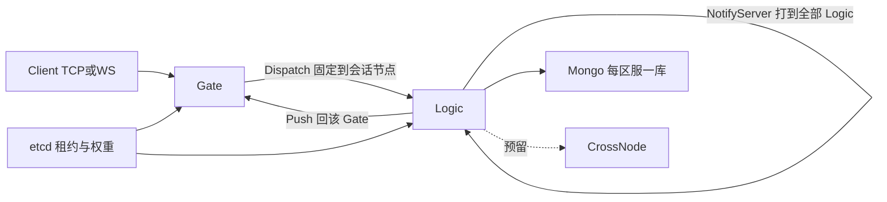
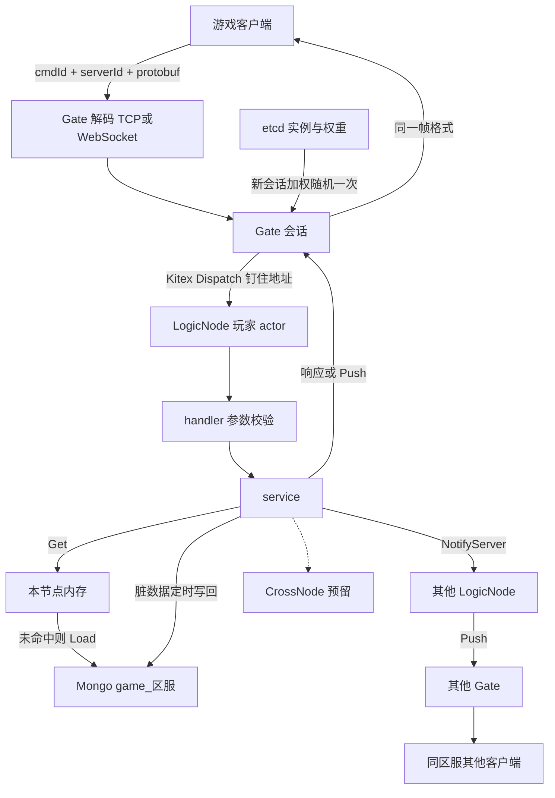

# Go 游戏后端框架

模块路径 `tuserv`。语言版本使用 Go 当前最新仍在维护的发布线：`go.mod` 写 `go 1.27`，工具链钉 `toolchain go1.27.3`（2026-10-19）。本机 SDK 目录是 `C:\Users\xuzha\.g\versions\1.27.3`，编译、测试和代码生成都调用该目录下的 `bin\go.exe`。Go 同时维护最近两个大版本，1.27 是其中较新的一条。客户端协议与 Kitex 分开：Gate 同时监听游戏端口和 Kitex 端口。

## 目录结构

框架在 `pkg`，三个进程在 `cmd`，玩法 demo 在 `example/demo`。单测与被测文件放在一起，不另建测试目录。`kitex_gen` 和 `example/demo/gen` 由工具生成，不手改。每个包用 `doc.go` 写包注释。

```text
TuServer/
├── go.mod                         # go 1.27，toolchain go1.27.3
├── go.sum
├── idl/
│   └── node.proto                 # Dispatch / NotifyServer / Push
├── kitex_gen/
│   └── node/
├── config/
│   ├── gate.yaml
│   ├── logic.yaml
│   └── cross.yaml
├── cmd/
│   ├── gate/main.go               # 调 tcp.Serve 或 ws.Serve，并注册 Kitex Gate
│   ├── logic/main.go
│   └── cross/main.go              # 只注册 CrossNode
├── pkg/
│   ├── protocol/
│   │   ├── codec.go               # Codec 接口
│   │   ├── frame.go               # 默认帧：长度 + cmdId + serverId + body
│   │   ├── tcp/server.go          # nbio.Engine，粘包缓冲
│   │   └── ws/server.go           # nbhttp + nbhttp/websocket
│   ├── router/router.go           # Router[K]、Register
│   ├── handler/context.go         # GetPlayer、BindPlayer
│   ├── actor/actor.go
│   ├── event/bus.go
│   ├── cache/cache.go             # Get、内部 Load、Flush
│   ├── store/mongo/store.go       # game_{serverId}
│   ├── entity/entity.go           # 脏标记、会话本地 / 按键路由
│   ├── log/
│   │   ├── log.go                 # Init、Debug/Info/Warn/Error、With
│   │   └── rotate.go              # 按天 + 按大小分割
│   └── cluster/
│       ├── registry.go            # etcd 注册与列实例
│       ├── pick.go                # 新会话加权随机
│       └── call.go                # WithHostPort、CallAll
└── example/
    └── demo/
        ├── proto/game.proto       # 1001–1006 与聊天推送 2001
        ├── gen/
        ├── register.go
        ├── handler/
        │   ├── login.go
        │   ├── levelup.go
        │   ├── item.go
        │   ├── chat.go
        │   └── guild.go
        ├── service/
        │   ├── player.go
        │   ├── bag.go
        │   ├── chat.go
        │   └── guild.go
        ├── entity/
        │   ├── player.go
        │   └── guild.go
        └── event/
            └── levelup.go         # PlayerLevelUp 监听，给背包加奖励
```

## 注释规则

开工时先把本节写入 [`.cursor/rules/go-comments.mdc`](.cursor/rules/go-comments.mdc)，`alwaysApply: true`。之后所有 Go 代码按这套规则写。

- 注释必须使用中文。
- 注释重点解释为什么，而不是做什么。代码本身应该能看懂在做什么。
- 避免无意义注释，例如 `// 设置名称` 后面直接跟着 `name = "xxx"`，以及 `// 返回结果`。
- 所有导出的函数、类型、方法、变量、常量必须写注释。
- 注释必须紧贴被注释的代码，中间不能有空行。
- 每个包的 `doc.go` 开头必须有包注释：

```go
// Package user 提供用户管理相关功能。
// 包含用户创建、认证和权限控制等能力。
package user
```

## 架构

区服不固定在某个 LogicNode。Gate 从 etcd 读出 Logic 实例和权重，**新会话加权随机选一次**，把地址记在会话上；之后该连接的包都用 `callopt.WithHostPort` 发到这个地址。同一区服的其他玩家可以在别的节点。节点崩溃或租约过期后，清掉绑定并重新加权选择，角色从 Mongo 再加载。



客户端到后端按一次请求往下走。游戏客户端只连 Gate，帧是 `cmdId + serverId + protobuf`。Gate 对新会话按权重选一台 LogicNode 并钉住，之后用 Kitex 把包交给该节点上的玩家 actor。handler 校验后进入 service，service 只通过 `Get` 碰实体：内存有就用内存，没有再从该区服的 Mongo 库加载。改动只打脏标记，定时写回。响应和主动推送都回到当初那台 Gate，再写成同一帧格式发给客户端。同区服聊天会再扇出到其他 LogicNode，由那些节点把推送交回各自的 Gate。



一条请求的路径：

- 游戏帧解码后进入 Gate 会话。尚无 Logic 地址时按权重挑选并钉住。
- Kitex `Logic.Dispatch` 只把请求丢进该玩家的 actor 邮箱，再等待结果。
- actor 内按协议键找到 handler。handler 做参数校验和简单逻辑，通过 `ctx.GetPlayer()` 拿角色；复杂逻辑进 service。
- service 只用 `Get`。`Get` 先读本节点内存，没有则 `Load` Mongo 并放入缓存。`Load` 不暴露给业务包。
- 修改实体只打脏标记。节点上的定时器按区服批量写回 Mongo。进程退出前再刷一次。
- 需要推给客户端时，Logic 按会话记下的 Gate 地址调用 `Gate.Push`。
- 通知某区服全部在线玩家：向所有 Logic 实例调用 `NotifyServer`，各节点只推自己内存里该 `serverId` 的会话。

共享实体（公会）不能在每个节点各缓存一份。框架按实体键做一致性哈希确定主人；`Get` 发现本节点不是主人时，用 Kitex 转到主人节点的 actor。公会 demo 走这条路径。CrossNode 只注册服务和空的 Kitex 骨架，不实现跨服玩法。

actor 处理中禁止同步 RPC 回自己。`NotifyServer` 用独立协程或 Kitex 单向调用发出。

## 协议与注册

默认帧（可替换编解码器）：`uint32 长度 | int32 cmdId | int32 serverId | protobuf body`。`serverId` 放在帧头，Gate 不用解析具体玩法协议就能选库、做广播。

面向客户端的 TCP 和 WebSocket 都用 `github.com/lesismal/nbio`。Kitex 的内部端口仍走 Kitex 自己的传输，不套 nbio。入口决定传输，不在框架里写死：

- [`pkg/protocol/tcp`](pkg/protocol/tcp) 使用 `nbio.Engine` 的 `OnOpen`、`OnData`、`OnClose`。`OnData` 拿到的是流式字节，连接上保留半包缓冲，凑齐一帧再交给 `Codec`。
- [`pkg/protocol/ws`](pkg/protocol/ws) 使用 `nbhttp.Engine` 和 `nbhttp/websocket`。一条二进制消息对应一帧，在 `OnMessage` 里交给同一个 `Codec`。
- 两个 `Serve(addr, codec, handler)` 由 `cmd/gate` 按配置调用，可以同时开。
- `OnData` 和 `OnMessage` 运行在 nbio 的 poller 上，里面只做拆包和把完整帧交给会话协程。Kitex `Dispatch` 在会话协程里调用，避免堵住 poller。回写使用 nbio 支持的并发 `Write` / `WriteMessage`。
- Windows 上 nbio 走标准库网络，只适合本机调试。Linux 上才是 epoll。

`Codec` 接口负责拆包和封包，默认实现是上面的帧。TCP 和 WebSocket 共用这一套。

注册表是泛型，默认键为 `int32`：

```go
type Router[K comparable] struct{}
func Register[K comparable, Req proto.Message, Resp proto.Message](
    r *Router[K], key K,
    h func(ctx *handler.Context, req *Req) (Resp, error),
)
```

`Register` 在进入用户函数前做 protobuf 反序列化。以后要改成字符串协议名，换一个 `Router[string]` 即可。多参数的包装以后加在注册辅助函数上，不改路由器本身。

[`pkg/handler/context.go`](pkg/handler/context.go) 提供 `GetPlayer()`，内部调用 player service 的 `Get`。登录完成前调用会返回明确错误。

## 数据与事件

- [`pkg/store/mongo`](pkg/store/mongo)：一个 Mongo 客户端，库名 `game_{serverId}`（前缀可配置）。集合按实体类型分。
- [`pkg/cache`](pkg/cache)：按 `serverId + 实体键` 放内存。`Get` / 内部 `Load` / `MarkDirty` / 定时 `Flush`。业务包只能看到 `Get`。
- 实体接口在 [`pkg/entity`](pkg/entity)：脏标记，以及会话本地 / 按键路由两种归属。`Player` 与 `Guild` 放在 [`example/demo/entity`](example/demo/entity)，setter 里打脏标记。
- [`pkg/event`](pkg/event)：进程内类型化订阅。例如升级时 `Publish(PlayerLevelUp{...})`，监听者在本进程执行。

## 日志

框架和 demo 只通过 [`pkg/log`](pkg/log) 打日志，包名是 `log`，import 路径是 `tuserv/pkg/log`。内部用标准库 `log/slog`。三个进程在监听端口之前调用 `Init`。业务代码不直接使用标准库 `log` 和 `log/slog`。

```go
log.Init(cfg)
log.Info("session bind", "server_id", serverID, "logic", addr)
log.Error("flush failed", "err", err)
ctx.Logger().Info("level up", "level", p.Level) // With 了 server_id、player_id、cmd_id
```

`handler.Context.Logger()` 返回 `log.With("server_id", "player_id", "cmd_id")`。Kitex 的 `klog` 接到同一个 `slog.Handler`，节点内部日志和 Kitex 日志进同一批文件。

配置写在各进程的 yaml 里：

```yaml
log:
  level: info          # debug info warn error
  format: text         # text 或 json
  dir: logs
  name: gate           # logic、cross 各自换名字
  max_size_mb: 100
  max_age_days: 7
  also_stdout: true
```

分割在 [`pkg/log/rotate.go`](pkg/log/rotate.go)，作为 `slog` 的 `io.Writer`：

- 当前文件是 `{dir}/{name}-2006-01-02.log`。日期变化时换新文件。
- 当天文件达到 `max_size_mb` 时，改名为 `{name}-2006-01-02.1.log`、`.2.log`，再写新的当天文件。
- 写入时删掉早于 `max_age_days` 的旧文件。
- 写文件加锁。`also_stdout` 为真时同时写到标准输出。

框架打这些点：进程启动与退出、会话绑定、Dispatch 或刷盘失败、etcd 注册失败。成功的普通协议包不打 Info。

## Kitex 与 etcd

IDL 只放内部方法，见 [`idl/node.proto`](idl/node.proto)：

- `Logic.Dispatch`：Gate 转发一条客户端包。
- `Logic.NotifyServer`：按 `serverId` 在本节点广播。
- `Gate.Push`：把一条包写回指定会话。

生成代码到 `kitex_gen`。游戏 cmd 不出现在这个 IDL 里。

[`pkg/cluster`](pkg/cluster) 包一层：

- Logic / Gate 启动时向 etcd 注册，带上权重。租约 TTL 用 `KITEX_ETCD_REGISTRY_LEASE_TTL`，默认在程序里设为 5 秒。
- `List(service)` 直接用 etcd resolver 拿实例，不把加权随机交给每次 RPC 的负载均衡。
- `PickWeighted` 只在会话首次绑定使用。
- `Call(host, method)` 使用 `WithHostPort`。
- `CallAll(service, method)` 给 `NotifyServer` 和以后的跨节点消息用。

## 第三方库

源码里只 import 下面这些模块，并写进 `go.mod`。版本在实现时取当前稳定版，由 `go mod tidy` 写入 `go.sum`。标准库（`log/slog`、`net`、`context` 等）不在此列。日志分割自己写，不引入 lumberjack 或 zap。配置解析只用 `yaml.v3`，不用 viper。

直接依赖：

- `github.com/cloudwego/kitex`：Gate、LogicNode、CrossNode 之间的 RPC，以及 `klog` 适配到 `pkg/log`。
- `github.com/kitex-contrib/registry-etcd`：向 etcd 注册、列实例、读取权重。源码不单独 import etcd 客户端。
- `go.mongodb.org/mongo-driver`：按区服连接 Mongo，读写实体文档。
- `google.golang.org/protobuf`：客户端协议和 `idl/node.proto` 的消息序列化。
- `github.com/lesismal/nbio`：Gate 上面向客户端的 TCP（`nbio.Engine`）和 WebSocket（`nbhttp`、`nbhttp/websocket`）。不负责 Kitex 端口。
- `gopkg.in/yaml.v3`：读取 `config/gate.yaml`、`config/logic.yaml`、`config/cross.yaml`。

代码生成，不链进进程：

- `protoc`：本机安装的 Protocol Buffers 编译器。
- `google.golang.org/protobuf/cmd/protoc-gen-go`：从 `example/demo/proto/game.proto` 生成 `example/demo/gen`。
- `github.com/cloudwego/kitex/tool/cmd/kitex`：从 `idl/node.proto` 生成 `kitex_gen`。

运行时会随 Kitex 和注册插件进来、但业务代码不直接引用的模块，版本锁在 `go.sum` 里。其中固定会用到的是 `go.etcd.io/etcd/client/v3`（租约与服务发现）。其余间接依赖不逐个写死。

## 进程入口

- [`cmd/gate`](cmd/gate)：先 `log.Init`，再开游戏监听 + Kitex `Gate.Push`，会话表（sessionId、serverId、playerId、logicAddr、连接）。
- [`cmd/logic`](cmd/logic)：先 `log.Init`，再提供 Kitex `Dispatch` / `NotifyServer`，actor 系统，缓存刷盘。
- [`cmd/cross`](cmd/cross)：先 `log.Init`，再向 etcd 注册 `CrossNode`，Kitex 服务空实现，供以后接入。

## 业务 Demo

实现放在 [`example/demo`](example/demo)，协议在 `example/demo/proto/game.proto`。下面是实现时要对齐的伪代码：handler 只做校验，改数据和发事件都在 service。角色缓存在会话所在节点，公会按实体键转到主人节点。`Publish` 在当前 actor 里同步执行，这样监听者改背包时不会和别的请求交叉。

```go
Register(router, 1001, onLogin)
Register(router, 1002, onLevelUp)
Register(router, 1003, onUseItem)
Register(router, 1004, onChat)
Register(router, 1005, onCreateGuild)
Register(router, 1006, onJoinGuild)

func onLogin(ctx *Context, req *LoginReq) (*LoginResp, error) {
    if req.Name == "" || len(req.Name) > 16 {
        return nil, ErrBadName
    }
    p, err := playerSvc.Login(ctx, ctx.ServerID, req.Name)
    if err != nil {
        return nil, err
    }
    ctx.BindPlayer(p.ID) // 响应带回 Gate，会话记下 playerId
    return &LoginResp{PlayerID: p.ID, Level: p.Level, Exp: p.Exp}, nil
}

func (s *PlayerService) Login(ctx, serverID, name) (*Player, error) {
    p, err := s.players.Get(ctx, serverID, name) // 内存没有则内部 Load，业务不调用 Load
    if err == ErrNotFound {
        p = NewPlayer(serverID, name) // level=1，MarkDirty
        s.players.Put(p)
    }
    return p, errOrNil(err, ErrNotFound)
}

func onLevelUp(ctx *Context, req *LevelUpReq) (*LevelUpResp, error) {
    if req.Exp <= 0 {
        return nil, ErrBadExp
    }
    p, err := playerSvc.AddExp(ctx, req.Exp)
    if err != nil {
        return nil, err
    }
    return &LevelUpResp{Level: p.Level, Exp: p.Exp}, nil
}

func (s *PlayerService) AddExp(ctx, exp int32) (*Player, error) {
    p, err := ctx.GetPlayer()
    if err != nil {
        return nil, err
    }
    p.Exp += exp
    for p.Exp >= need(p.Level) {
        p.Exp -= need(p.Level)
        p.Level++
        s.bus.Publish(ctx, PlayerLevelUp{Player: p, Level: p.Level})
    }
    p.MarkDirty()
    return p, nil
}

func onLevelUpReward(ctx Context, ev PlayerLevelUp) {
    ev.Player.Bag.Add(rewardItemID, 1)
    ev.Player.MarkDirty()
}

func onUseItem(ctx *Context, req *UseItemReq) (*UseItemResp, error) {
    if req.ItemID <= 0 || req.Count <= 0 {
        return nil, ErrBadArg
    }
    left, err := bagSvc.Use(ctx, req.ItemID, req.Count)
    if err != nil {
        return nil, err
    }
    return &UseItemResp{ItemID: req.ItemID, Left: left}, nil
}

func (s *BagService) Use(ctx, itemID, count int32) (int32, error) {
    p, err := ctx.GetPlayer()
    if err != nil {
        return 0, err
    }
    if p.Bag.Count(itemID) < count {
        return 0, ErrNotEnough
    }
    p.Bag.Add(itemID, -count)
    p.MarkDirty()
    return p.Bag.Count(itemID), nil
}

func onChat(ctx *Context, req *ChatReq) (*ChatResp, error) {
    if len(req.Text) < 1 || len(req.Text) > 80 {
        return nil, ErrBadText
    }
    return &ChatResp{}, chatSvc.Send(ctx, req.Text)
}

func (s *ChatService) Send(ctx, text string) error {
    p, err := ctx.GetPlayer()
    if err != nil {
        return err
    }
    body := encode(ChatPush{Name: p.Name, Text: text})
    go s.cluster.CallAll("Logic", "NotifyServer", &NotifyReq{
        ServerID: ctx.ServerID, CmdID: 2001, Body: body,
    })
    return nil
}

func (n *Logic) NotifyServer(req *NotifyReq) error {
    for _, sess := range n.localSessions(req.ServerID) {
        n.cluster.Call(sess.GateAddr, "Gate.Push", &PushReq{
            SessionID: sess.ID, CmdID: req.CmdID, Body: req.Body,
        })
    }
    return nil
}

func onCreateGuild(ctx *Context, req *CreateGuildReq) (*GuildResp, error) {
    if req.Name == "" || len(req.Name) > 16 {
        return nil, ErrBadName
    }
    g, err := guildSvc.Create(ctx, req.Name)
    if err != nil {
        return nil, err
    }
    return &GuildResp{GuildID: g.ID, Name: g.Name}, nil
}

func (s *GuildService) Create(ctx, name string) (*Guild, error) {
    p, err := ctx.GetPlayer()
    if err != nil {
        return nil, err
    }
    if p.GuildID != 0 {
        return nil, ErrAlreadyInGuild
    }
    g := NewGuild(ctx.ServerID, name, p.ID) // MarkDirty
    if err := s.guilds.CreateOnOwner(ctx, g); err != nil {
        return nil, err // 非主人则 Kitex 到主人 actor 再执行
    }
    p.GuildID = g.ID
    p.MarkDirty()
    return g, nil
}

func onJoinGuild(ctx *Context, req *JoinGuildReq) (*GuildResp, error) {
    if req.GuildID == 0 {
        return nil, ErrBadArg
    }
    g, err := guildSvc.Join(ctx, req.GuildID)
    if err != nil {
        return nil, err
    }
    return &GuildResp{GuildID: g.ID, Name: g.Name}, nil
}

func (s *GuildService) Join(ctx, guildID int64) (*Guild, error) {
    p, err := ctx.GetPlayer()
    if err != nil {
        return nil, err
    }
    if p.GuildID != 0 {
        return nil, ErrAlreadyInGuild
    }
    g, err := s.guilds.Get(ctx, ctx.ServerID, guildID) // 只 Get，主人节点上才进入内存
    if err != nil {
        return nil, err
    }
    g.AddMember(p.ID)
    g.MarkDirty()
    p.GuildID = g.ID
    p.MarkDirty()
    return g, nil
}
```

## 验证

- 单测：帧编解码、`Router[int32]` 与 `Router[string]`、加权随机比例、脏缓存 `Get` 不重复 `Load`、事件发布。日志分割用临时目录：换日期或超过大小后出现新文件，超龄文件被删掉，`Info` 的文本里带上 `With` 的字段。
- demo 单测不依赖 etcd：直接把包送进 actor。登录创建角色；升级后等级与奖励道具变化；道具不足时报错；聊天 service 收到的广播目标包含该 `serverId`；公会创建后成员列表含创建者。
- 缓存与路由单测用假的存储和假的实例列表，不依赖本机 etcd。
- 有 etcd 和 Mongo 时再跑冒烟：两台 Logic 不同权重，Gate 用 TCP 依次发登录、升级、使用道具、聊天。确认会话钉住同一节点，升级事件改到背包，聊天推送到达同区服连接。
